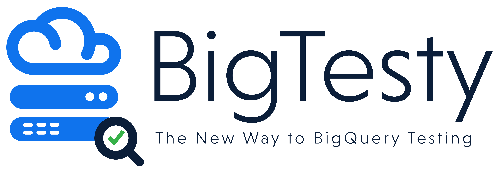
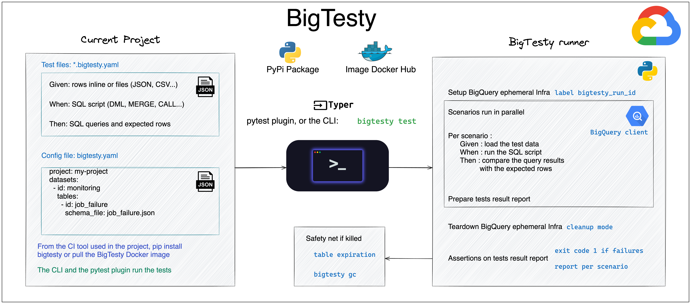

BigTesty is an integration testing framework for BigQuery, running the tests on a real and short-lived
infrastructure.

- **The real BigQuery engine**, no emulator: the SQL behaves exactly as in production.
- **Given / When / Then** test files in YAML or JSON: load test data, run any SQL (queries, DML, `MERGE`,
  scripts, procedures), then assert on query results or table contents.
- **Isolated and ephemeral**: each scenario of each run gets its own datasets, created and destroyed by BigTesty.
  Several developers and CI pipelines can run the tests at the same time.
- **Production SQL unchanged**: the references to your datasets are rewritten to the isolated datasets.



The story of BigTesty 1.x, and how it tests the production SQL as is:
[Don't mock BigQuery, test on BigQuery](https://medium.com/@mazlum.tosun/dont-mock-bigquery-test-on-bigquery-the-rewrite-of-bigtesty-e3fdb0bbbb57).

## Quick start

```bash
uv add --dev bigtesty
gcloud auth application-default login
```

Write a `bigtesty.yaml` [config file](/bigtesty/writing-tests/project-config/) declaring the datasets and tables,
and [test files](/bigtesty/writing-tests/test-files/) with Given / When / Then scenarios:

```yaml
scenarios:
  - name: find_failures_by_job_name
    given:
      - table: monitoring.job_failure
        rows:
          - { featureName: myFeature, jobName: jobPSG, dwhCreationDate: "2022-05-06 17:38:10" }
          - { featureName: myFeature, jobName: otherJob, dwhCreationDate: "2022-05-07 08:00:00" }
    then:
      - query: SELECT * FROM `monitoring.job_failure` WHERE jobName = 'jobPSG'
        compare_columns: expected_only
        expected:
          - { jobName: jobPSG, dwhCreationDate: "2022-05-06T17:38:10Z" }
```

Then run the tests:

```bash
bigtesty test --project $PROJECT_ID
```

Runnable examples, from the basics to a uv project with its CI and the production SQL, are listed in [Examples](/bigtesty/examples/).
